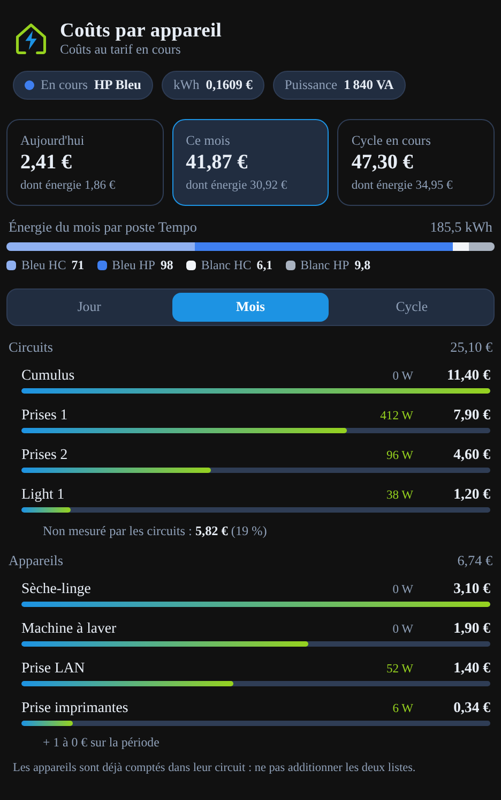
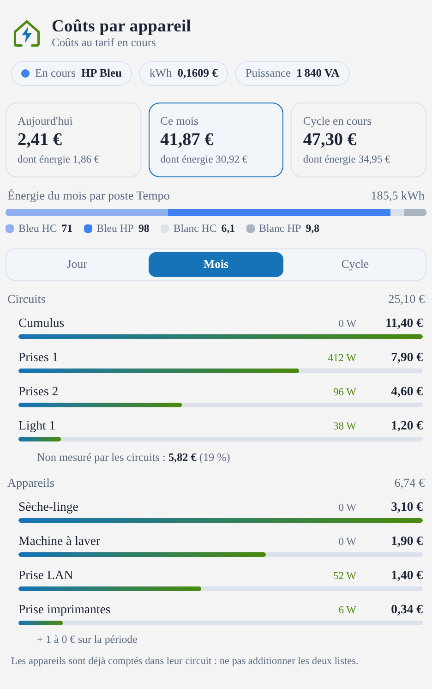

# Carte Linky Appareils

Carte Lovelace pour Home Assistant qui affiche **ce que coûte chaque circuit et chaque appareil** : aujourd'hui, ce mois et sur le cycle de facturation, avec le poste Tempo en cours, le prix du kWh et la puissance instantanée.

Elle a le même style que la [Carte Enedis Linky New](https://github.com/Marlboro62/content-card-linky-new), mais elle est **indépendante** : elle s'installe à part, avec son propre type `custom:linky-appareils-card`, et ne remplace pas la carte Linky. Les deux peuvent être affichées sur le même tableau de bord.

| Style MyElectricalData (sombre) | Clair |
| --- | --- |
|  |  |

## Ce que la carte affiche

- **En-tête** : poste Tempo en cours (ex. « HP Bleu »), prix du kWh et puissance du logement.
- **Trois tuiles** : aujourd'hui, ce mois et cycle en cours, abonnement compris, avec la part énergie. Un clic sur une tuile change de période.
- **Énergie du mois par poste Tempo** : Bleu, Blanc et Rouge, en heures creuses et pleines.
- **Onglets Jour / Mois / Cycle** avec deux classements :
  - **Circuits** : les départs du tableau électrique, avec la part que les circuits ne mesurent pas ;
  - **Appareils** : prises connectées et appareils suivis.
- Chaque ligne donne la puissance actuelle (en vert quand l'appareil consomme), le coût de la période et une barre comparative. Un clic ouvre le capteur.
- Les appareils à 0 € sont regroupés sur une seule ligne (option `show_zero` pour les afficher).

> Les appareils sont en général déjà comptés dans leur circuit : il ne faut pas additionner les deux listes.

## Installation

### Avec HACS (recommandé)

1. Dans HACS, menu **⋮** → **Dépôts personnalisés**.
2. Ajoutez `https://github.com/Marlboro62/linky-appareils-card` avec le type **Tableau de bord** (Dashboard).
3. Cherchez **Carte Linky Appareils**, installez-la, puis rechargez la page (Ctrl+F5).

### Manuellement

1. Téléchargez `linky-appareils-card.js` depuis la [dernière release](https://github.com/Marlboro62/linky-appareils-card/releases/latest) et copiez-le dans `/config/www/`.
2. **Paramètres → Tableaux de bord → ⋮ → Ressources → Ajouter une ressource** :
   - URL : `/local/linky-appareils-card.js`
   - Type : **Module JavaScript**
3. Rechargez la page (Ctrl+F5).

## Capteurs nécessaires

La carte ne calcule rien elle-même : elle affiche des capteurs de coût que vous créez dans Home Assistant (par exemple avec des `utility_meter` et des capteurs template multipliant l'énergie par le prix du kWh).

### Circuits et appareils

**Sans configuration**, la carte trouve toute seule les capteurs nommés :

```
sensor.cout_<nom>_jour
sensor.cout_<nom>_mois
sensor.cout_<nom>_cycle
```

- Ceux qui commencent par `sensor.cout_disjoncteur_` vont dans **Circuits**, les autres dans **Appareils**.
- Si un capteur `sensor.<nom>_power` existe, sa valeur est affichée comme puissance actuelle.
- Le nom affiché vient du nom convivial du capteur, sans « Coût », « Disjoncteur » ni la période.

**Avec configuration**, vous listez vous-même les entités (voir l'exemple plus bas). Dès que `circuits:` ou `devices:` est présent, la détection automatique est désactivée.

### En-tête, tuiles et répartition Tempo

| Option | Rôle | Valeur par défaut |
| --- | --- | --- |
| `tarif` | Poste Tempo en cours, texte du type « HP BLEU » | `sensor.lixee_current_price` |
| `price` | Prix du kWh en cours | `sensor.tempo_tarif_ttc_actuel` |
| `power` | Puissance instantanée du logement | `sensor.lixee_sinsts` |
| `cost_day` | Coût total aujourd'hui (abonnement compris) | `sensor.tempo_cout_total_aujourd_hui` |
| `cost_month` | Coût total du mois | `sensor.tempo_cout_total_ce_mois` |
| `cost_cycle` | Coût total du cycle de facturation | `sensor.tempo_cout_total_cycle_en_cours` |
| `energy_day` | Coût énergie seule aujourd'hui | `sensor.tempo_cout_energie_aujourd_hui` |
| `energy_month` | Coût énergie seule du mois | `sensor.tempo_cout_energie_ce_mois` |
| `energy_cycle` | Coût énergie seule du cycle | `sensor.tempo_cout_energie_cycle_en_cours` |
| `kwh_prefix` | Préfixe des capteurs `<couleur>_<hc\|hp>_energie_ce_mois` (kWh) | `sensor.tempo_` |

Une option dont le capteur n'existe pas est simplement masquée.

## Options d'affichage

| Option | Rôle | Défaut |
| --- | --- | --- |
| `title` | Titre de la carte | `Coûts par appareil` |
| `period` | Onglet ouvert au chargement : `jour`, `mois` ou `cycle` | `mois` |
| `show_split` | Afficher l'énergie du mois par poste Tempo | `true` |
| `show_zero` | Afficher les appareils à 0 € au lieu de les regrouper | `false` |
| `theme` | `v2` (bleu nuit MyElectricalData), `auto` (clair ou sombre selon HA), `ha` (thème Home Assistant) | `v2` |

Toutes les options sont aussi disponibles dans l'**éditeur visuel**.

## Exemples

Configuration minimale, avec la détection automatique :

```yaml
type: custom:linky-appareils-card
```

Configuration complète avec listes explicites : voir [`exemples/carte-appareils.yaml`](exemples/carte-appareils.yaml).

Chaque élément de `circuits:` ou `devices:` accepte :

| Clé | Rôle |
| --- | --- |
| `name` | Nom affiché |
| `icon` | Icône (ex. `mdi:water-boiler`), `mdi:flash` par défaut |
| `jour` (ou `day`) | Capteur de coût du jour |
| `mois` (ou `month`) | Capteur de coût du mois |
| `cycle` | Capteur de coût du cycle |
| `power` | Capteur de puissance en W (facultatif) |

## Support

Questions et problèmes : uniquement via les [issues GitHub](https://github.com/Marlboro62/linky-appareils-card/issues).

## Voir aussi

- [Carte Enedis Linky New](https://github.com/Marlboro62/content-card-linky-new) : consommation et production Linky via MyElectricalData.
- [Add-on MyElectricalData new](https://github.com/Marlboro62/hassio-addons) pour Home Assistant.

Si la carte vous est utile : [Buy Me a Coffee](https://buymeacoffee.com/marlboro62) · [Ko-fi](https://ko-fi.com/nothing_one)

## Licence

MIT
